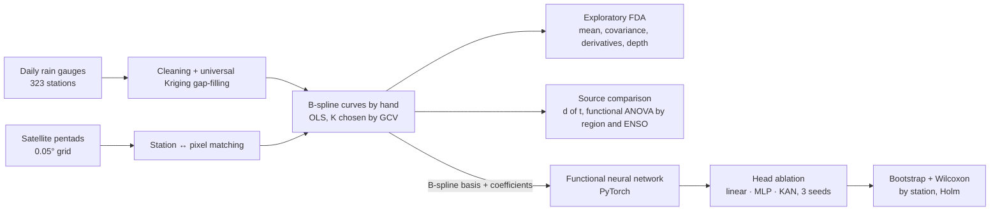

# Functional Rainfall Bias Correction

**Correcting satellite rainfall bias in Valle del Cauca, Colombia (1981–2003) with functional data analysis and a functional neural network: linear vs. MLP vs. KAN heads.**


Final project for **Analítica de Datos** (Data Analytics), Universidad Autónoma de Occidente, Cali, 2026-2S.

---

## Overview

Every year of rainfall at a location is treated as a **curve**, not as 365 separate numbers. The project builds those curves for two sources, rain gauges (daily, point) and a CHIRPS-like satellite product (5-day pentads, 0.05° grid), describes them, compares them, and trains a **function-to-function neural network** that maps the satellite curve of a year to the rain-gauge curve.

| | |
|---|---|
| **Stations** | 161 rain gauges, 2969 station-year curves after cleaning |
| **Satellite** | 72 pentads per year, 0.05° grid, matched by the cell that contains each station |
| **Split** | Temporal: 1981–1995 train · 1996–2000 validation · 2001–2003 test |
| **Climate index** | ONI (NOAA CPC, ERSSTv5), ENSO phases with the IDEAM criterion |

### Key results (test set, 2001–2003)

| Model | Relative L² error ↓ | KGE ↑ | Annual bias |
|---|---:|---:|---:|
| Uncorrected satellite | 0.522 | 0.373 | +28.5 % |
| Station climatology | 0.377 | 0.523 | +13.3 % |
| Functional net · linear head | 0.351 | **0.595** | +6.7 % |
| Functional net · MLP head | **0.343** | 0.589 | **+4.6 %** |
| Functional net · KAN head | 0.361 | 0.577 | +5.8 % |

All three heads beat both the raw satellite and the station climatology. Every difference has a 95 % station-level bootstrap CI that excludes zero, and a significant Wilcoxon signed-rank test with Holm correction. The KAN does not beat the linear head at equal parameter budget, but its edge activations are well described by cubic polynomials (R² 0.96–0.98), and its ONI response matches regional climatology (El Niño dries the valley).

---

## Pipeline



### 1. Data cleaning (R)

Accumulated multi-day totals logged on one day, impossible values (> 500 mm/day), false zeros (checked against the 5 nearest stations within 30 km), a 365-day calendar, **universal Kriging** gap-filling (trend on coordinates and altitude, exponential semivariogram, never applied to test years), ≥ 95 % daily coverage per station-year and ≥ 4 valid years per station. Every step reports stations and station-years kept, and no decision uses the test period.

### 2. Functional data (R, written from scratch)

- Cubic B-spline basis built with the **Cox–de Boor recursion**, coefficients by ordinary least squares.
- Number of basis functions chosen with MSE, CV and **GCV**: K = 8 for stations, K = 9 for satellite.
- Numerical checks: smoothing matrix idempotent with trace K (error ~1e-15); basis and coefficients match `fda` to 1e-14.
- Heteroscedastic residual covariance and pointwise confidence bands, Var[ĉ] = CΣCᵀ.

### 3. Exploratory analysis and source comparison (R)

Functional mean, variance, covariance and correlation; derivatives to date the two rainy seasons; Fraiman–Muniz and MBD depth; functional boxplots. Station-minus-satellite difference curve d(t) with ±2 SE bands, cross-correlation, and **functional ANOVA by permutation** across sub-regions and ENSO phases.

The satellite captures the bimodal regime but flattens orography: it underestimates the Pacific slope by 857 mm/yr and overestimates the north by 479 mm/yr. It also barely follows ENSO: the correlation between ONI and the annual station-minus-satellite difference is −0.71.

### 4. Functional neural network (PyTorch)

$$
\tilde X(t)=X(t)-\bar X_s(t)
\;\;\rightarrow\;\;
z_k=\int w_k(t)\,\tilde X(t)\,dt=\mathbf a_k^\top W\tilde{\mathbf c}
\;\;\rightarrow\;\;
\boldsymbol\xi=h(\mathbf z,\mathrm{ONI})
\;\;\rightarrow\;\;
\hat y(t)=\bar Y_s(t)+\mu_r(t)+\sum_{m=1}^{6}\xi_m\psi_m(t)
$$

- **Encoder:** 6 functional neurons whose weight functions w<sub>k</sub>(t) live in the B-spline basis. W is the Gram matrix computed by trapezoidal quadrature.
- **Residual on climatology:** the network learns how a given year departs from the station's training-period mean curve, driven by the satellite anomaly and ONI. Altitude is deliberately excluded, because a fixed per-station input lets the network memorise each station.
- **Decoder:** frozen FPCA basis (M = 6, 86.9 % variance) fitted on training data only.
- **Loss:** functional L² norm, equal to (ĉ − c)ᵀW(ĉ − c), plus a roughness penalty on w<sub>k</sub>. Modelled on √P with non-negative reconstruction in mm.
- **Linear head = functional regression:** proven in closed form, β(s,t) = Σ<sub>k</sub>Σ<sub>m</sub> w<sub>k</sub>(s) B<sub>mk</sub> ψ<sub>m</sub>(t), and verified numerically (max difference 2.7e-7).

### 5. Head ablation and evaluation

| Head | Architecture | Parameters |
|---|---|---:|
| Linear | ξ = B[z; ONI] + b | 48 |
| MLP | Linear(7→146) · GELU · Dropout · Linear(146→6) | 2050 |
| KAN | Linear(7→32) · Dropout · KANLayer(32→6), FastKAN-style Gaussian RBF edges | 2048 |

Same encoder, decoder and training budget for every head: AdamW + OneCycleLR, 4 hyperparameter trials, up to 150 epochs, early stopping on validation, 3 seeds. The KAN is first checked on a synthetic target, sin(πx₁) + x₂², reaching RMSE 0.0021. Metrics are relative L², KGE, annual-total bias and timing error of both rainfall peaks, with 2000-resample station-level bootstrap, Wilcoxon tests and per-ENSO-phase results.

---

## Repository structure

```
├── Proyecto_Final_Estadistica.R   # cleaning, Kriging, functional data, EDA, source comparison, Wilcoxon
├── Proyecto_Final_IA.py           # functional neural network, ablation, evaluation, interpretation
├── requirements.txt               # Python dependencies (pinned)
└── README.md
```

Code comments and outputs are in Spanish, the course language.

## How to run

**Data.** The input files are not included in this repository. Place them next to the scripts:

```
P_1980_1990.csv  P_1991_2003.csv                                  # daily rain-gauge records
CVC_Wheather_Stations_Long_Lat.csv  CatalogoEstacionesElevacion.xlsx   # station catalogue
ImagenesSatelitePentadal.zip                                      # satellite pentads
```

**1. R:** run `Proyecto_Final_Estadistica.R` top to bottom. It writes `Salidas_imputacion/` and `Figuras_imputacion/`, plus the B-spline basis and curve coefficients that Python reads.

**2. Python:**

```bash
python -m venv venv_pf
venv_pf\Scripts\activate          # Linux/macOS: source venv_pf/bin/activate
pip install -r requirements.txt
python Proyecto_Final_IA.py       # ~5 min on CPU
```

It writes `Salidas_IA/` (metrics, bootstrap, checkpoints, predictions) and `Figuras_IA/`.

**3. R again:** run the block `#Ítem 4.4. Prueba de Wilcoxon pareada por estación` to get the paired Wilcoxon tests.

Both scripts use relative paths and fixed seeds. R package versions are written to `Salidas_imputacion/versiones_paquetes.txt`. The R script opens plots with `windows()`, so it is meant for Windows.

---

## Team

- Carlos Andrés Orozco
- Esteban Cobo Gómez
- Jose David Mesa
- Sara Lucía Rojas

**Course:** Analítica de Datos 2026-2S, Universidad Autónoma de Occidente. Instructors: Johann A. Ospina (functional statistics) and Carlos A. Ferro (deep learning).

## References

- Ramsay, J. O. & Silverman, B. W. (2005). *Functional Data Analysis*. Springer.
- Rossi, F. & Conan-Guez, B. (2005). Functional multi-layer perceptron. *Neural Networks*, 18(1).
- Liu, Z. et al. (2024). KAN: Kolmogorov–Arnold Networks. arXiv:2404.19756.
- Li, Z. (2024). Kolmogorov–Arnold Networks are Radial Basis Function Networks. arXiv:2405.06721.
- Funk, C. et al. (2015). The CHIRPS dataset. *Scientific Data*, 2, 150066.
- Gupta, H. V. et al. (2009). Decomposition of the MSE and NSE criteria. *Journal of Hydrology*, 377.
