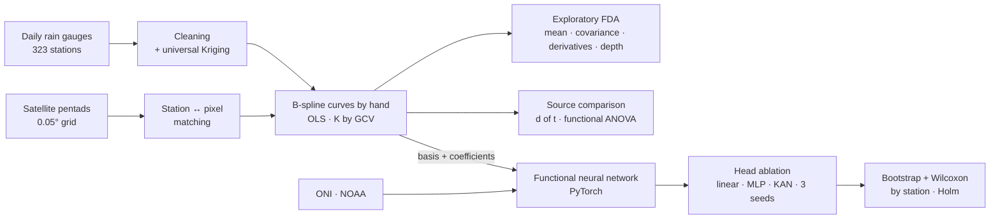
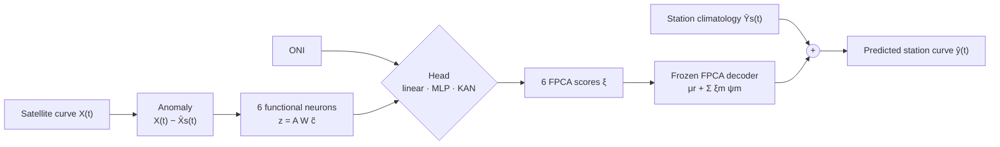

# Functional Rainfall · Satellite bias correction with functional neural networks

[](https://www.r-project.org/)
[](https://www.python.org/)
[](https://pytorch.org/)
[](https://cran.r-project.org/package=fda)
[](https://arxiv.org/abs/2405.06721)
[](https://www.chc.ucsb.edu/data/chirps)
[](https://origin.cpc.ncep.noaa.gov/products/analysis_monitoring/ensostuff/ONI_v5.php)

**Functional Rainfall** reconstructs the rainfall a ground station actually recorded from what a satellite saw over it. Each year of rain at a location is treated as one **curve**, not 365 loose numbers: the curves are built by hand with B-splines, described and compared with functional statistics, and then a **function-to-function neural network** learns to correct the satellite curve of each year, with a head ablation between a linear head (equivalent to functional regression), an MLP and a Kolmogorov–Arnold Network (KAN).

Applied to **Valle del Cauca, Colombia, 1981–2003**: 323 rain gauges from the regional environmental authority (CVC) and a CHIRPS-like satellite product at 0.05°, in 5-day pentads.

**Highlights**

- Functional data **built from scratch** in R: Cox–de Boor B-spline basis, OLS coefficients, K chosen by GCV, smoothing matrix checked to 1e-15 against `fda`
- Gaps filled with **universal Kriging** day by day, validated with leave-one-station-out cross-validation against kNN and neighbour averages
- Functional neural network with **6 functional neurons** (Gram matrix by quadrature) and a frozen **FPCA decoder**, plus a written proof that the linear head is a low-rank functional regression, verified numerically to **2.7e-7**
- Test error cut from **0.522** (raw satellite) and **0.377** (station climatology) to **0.343** relative L², and annual bias from **+28.5 %** to **+4.6 %**
- Fair ablation: KAN and MLP matched to **±0.1 %** in parameters, 3 seeds, same budget, 2000-resample station-level **bootstrap** and **Wilcoxon** tests with Holm correction
- No leakage: every cleaning rule, basis, FPCA, scale and hyperparameter is chosen without the test years

> My role: **statistics lead and end-to-end integration**. Data cleaning and functional curves in R, cross-checks between the R and Python pipelines on separate machines, and the paired Wilcoxon evaluation. Team credits are [below](#team).

---

## The problem

Valle del Cauca has very uneven rainfall: from under 1000 mm/yr in the rain-shadow canyons to almost 10,000 mm/yr on the Pacific slope, with two rainy seasons a year driven by the double passage of the Intertropical Convergence Zone, and strong year-to-year swings with El Niño and La Niña. Rain gauges are accurate but sparse and full of gaps. Satellite products cover everything but blur the terrain.

Measured here, the satellite reproduces the bimodal regime but **flattens the orography**: it underestimates the Pacific slope by **857 mm/yr** and overestimates the north by **479 mm/yr**. It also **barely follows ENSO**: the correlation between the ONI and the annual station-minus-satellite difference is **−0.71**. Its bias depends on place and year, so it cannot be corrected with a single factor.

## What it does

- **Cleans the gauge records with explicit, counted rules.** Multi-day totals logged on one day, impossible values, false zeros checked against the nearest stations, a 365-day calendar, Kriging gap-filling, coverage and minimum-years rules, with stations and station-years reported after every step.
- **Turns every station-year into a smooth curve.** Both sources go onto the same annual domain in mm/day, with heteroscedastic pointwise confidence bands.
- **Describes and compares the two sources functionally.** Mean, covariance, derivatives (start and end of each rainy season), depth and functional boxplots, the difference curve d(t) with its significant intervals, and functional ANOVA by permutation across sub-regions and ENSO phases.
- **Learns the correction.** A functional neural network predicts how each year departs from the station's own climatology, from the satellite anomaly and the ONI.
- **Explains it.** Weight functions w<sub>k</sub>(t) show which window of the year each neuron reads, KAN edges are fitted with symbolic expressions, and the partial effect of the ONI is checked against regional climatology.

## Key results

Test set, 2001–2003, 334 station-year curves; heads averaged over 3 seeds.

| Model | Relative L² ↓ | KGE ↑ | Annual bias | Peak timing (days) |
|---|---:|---:|---:|---:|
| Uncorrected satellite | 0.522 | 0.373 | +28.5 % | 30.4 / 23.2 |
| Station climatology | 0.377 | 0.523 | +13.3 % | 27.7 / 21.3 |
| Functional net · linear head | 0.351 | **0.595** | +6.7 % | **24.6** / 18.9 |
| Functional net · MLP head | **0.343** | 0.589 | **+4.6 %** | 24.9 / 18.6 |
| Functional net · KAN head | 0.361 | 0.577 | +5.8 % | 25.3 / **18.5** |

- All three heads beat the satellite and the climatology. The 95 % bootstrap CIs exclude zero and the Wilcoxon tests are significant after Holm.
- **Ablation reading:** the non-linear part of the bias is small. The MLP beats the linear head by 0.008 on test but loses on validation, and interpretability costs the KAN 0.009 against the linear head.
- **What the KAN gives back:** its strongest edges are fitted by cubic polynomials with R² 0.96–0.98, and its ONI response (about −170 mm/yr per °C) matches the ENSO signal found in the functional ANOVA.

---

## Technical highlights

| Area | What was built and why |
|---|---|
| **Functional data by hand** | Φ from the Cox–de Boor recursion and ĉ = (ΦᵀΦ)⁻¹Φᵀy, so heteroscedasticity and autocorrelation of the residuals can be inspected, which libraries hide. K = 8 (stations) and 9 (satellite) by GCV. S is idempotent with trace K, and Φ and ĉ match `fda` to 1e-14. |
| **Uncertainty** | Residual variance changes 17× along the year, so the bands use Var[ĉ] = CΣCᵀ instead of a constant variance. They are pointwise and reported as such. |
| **Gap-filling** | Universal Kriging per day, Z(s) = b₀ + b₁x + b₂y + b₃·altitude + e(s), with an exponential semivariogram fitted on standardized residuals. Only pairs with ≥ 80 % own data, stations ≤ 2000 m and years ≤ 2000. The test years are never filled. |
| **Functional inference** | d(t) = station − satellite with ±2 SE bands; functional ANOVA (F, GPF and F-max by permutation) by sub-region and ENSO phase, with Holm for pairwise comparisons. |
| **Functional encoder** | z<sub>k</sub> = ∫ w<sub>k</sub>(t) X̃(t) dt = a<sub>k</sub>ᵀWc̃, with w<sub>k</sub> in the B-spline basis and W from trapezoidal quadrature (1ᵀW1 = 365). A roughness penalty on second differences keeps w<sub>k</sub> smooth. |
| **Residual on climatology** | ŷ(t) = Ȳ<sub>s</sub>(t) + μ<sub>r</sub>(t) + Σ ξ<sub>m</sub>ψ<sub>m</sub>(t). The fixed part of each station comes from its own training-period mean curve, and the network only learns the yearly anomaly. Altitude was removed as an input because, being fixed per station, it let the network memorise stations. |
| **Proof + check** | Linear head ⇒ ŷ − Ȳ<sub>s</sub> = α(t) + ∫β(s,t)X̃(s)ds + γ(t)·ONI with β(s,t) = Σ<sub>k</sub>Σ<sub>m</sub> w<sub>k</sub>(s)B<sub>mk</sub>ψ<sub>m</sub>(t), a rank-≤ 6 function-on-function regression. Rebuilt from the trained weights, it matches the network to 2.7e-7. |
| **Fair ablation** | Same encoder, frozen FPCA decoder (M = 6, 86.9 % variance) and budget for every head: AdamW + OneCycleLR, 4 trials, 150 epochs max, early stopping on validation, 3 seeds. KAN 2048 vs MLP 2050 parameters with `sum(p.numel())`. The KAN is checked first on sin(πx₁) + x₂² (RMSE 0.0021). |
| **Honest evaluation** | Metrics averaged per station before resampling, because curves from one station are not independent. Bootstrap CIs and Wilcoxon with Holm over 9 comparisons, per-ENSO results, and inter-annual metrics that check whether a model follows the year or only the mean. |
| **Reproducibility** | One R script and one Python script, relative paths, fixed seeds, pinned `requirements.txt`, R package versions written on every run, and 8 automatic numeric checks printed at the end of the Python run. |

---

## Pipeline



### Network



| Head | Architecture | Parameters |
|---|---|---:|
| Linear | ξ = B[z; ONI] + b | 48 |
| MLP | Linear(7→146) · GELU · Dropout · Linear(146→6) | 2050 |
| KAN | Linear(7→32) · Dropout · KANLayer(32→6), Gaussian RBF edges + SiLU base | 2048 |

### Data cleaning

| Step | Rule | Stations | Station-years |
|---|---|---:|---:|
| 0 | Original records 1981–2003 | 323 | 5514 |
| 1 | Multi-day totals logged on one day | 323 | 5510 |
| 2 | Impossible values (< 0 or > 500 mm/day) | 323 | 5510 |
| 3 | Coordinates inside the satellite grid | 178 | 3314 |
| 4 | False zeros (5 nearest stations ≤ 30 km) | 178 | 3314 |
| 5 | 365-day calendar | 178 | 3314 |
| 5b | Universal Kriging gap-filling | 178 | 3314 |
| 6 | ≥ 95 % daily coverage | 175 | 2995 |
| 7 | ≥ 4 valid years, counted up to 2000 only | 161 | 2969 |

Temporal split: 1981–1995 training (2019 curves), 1996–2000 validation (616), 2001–2003 test (334).

## Stack

| Layer | Technology |
|---|---|
| Statistics | R 4.5, `data.table`, `fda`, `fda.usc`, `terra`, `readxl` |
| Deep learning | Python, PyTorch 2.15, NumPy, SciPy, pandas, Matplotlib |
| Methods | B-splines, GCV, functional ANOVA, depth, universal Kriging, FPCA, functional neurons, KAN, bootstrap, Wilcoxon |
| Data | CVC rain gauges, CHIRPS-like satellite pentads, NOAA CPC ONI (ERSSTv5), IDEAM ENSO criterion |

## Quick start

```bash
git clone https://github.com/ShadowBlack33/Functional-Rainfall-Bias-Correction.git
cd Functional-Rainfall-Bias-Correction
```

**Data.** The input files are not in the repository (they were delivered with the course). Place them next to the scripts:

```
P_1980_1990.csv, P_1991_2003.csv                         daily rain-gauge records
CVC_Wheather_Stations_Long_Lat.csv                       station coordinates
CatalogoEstacionesElevacion.xlsx                         station altitude catalogue
ImagenesSatelitePentadal.zip                             satellite pentads (unzipped by the script)
```

**1. R:** run `Proyecto_Final_Estadistica.R` top to bottom. It writes `Salidas_imputacion/` and `Figuras_imputacion/`, including the B-spline basis and curve coefficients that Python reads.

**2. Python** (about 5 minutes on CPU):

```bash
python -m venv venv_pf
venv_pf\Scripts\activate            # Linux/macOS: source venv_pf/bin/activate
pip install -r requirements.txt
python Proyecto_Final_IA.py
```

It writes `Salidas_IA/` (metrics, bootstrap, predictions, checkpoints with SHA-256 fingerprints) and `Figuras_IA/`.

**3. R again:** run the block `#Ítem 4.4. Prueba de Wilcoxon pareada por estación` to get the paired tests in `Salidas_imputacion/wilcoxon_por_estacion.csv`.

## Repository

```
├── Proyecto_Final_Estadistica.R   cleaning, Kriging, functional curves, EDA, source comparison, Wilcoxon
├── Proyecto_Final_IA.py           functional neural network, ablation, evaluation, interpretation
├── requirements.txt               pinned Python dependencies
└── README.md
```

Code comments, outputs and figures are in Spanish, the language of the course.

## Known limitations

Stated as the path forward, not presented as working:

- The test period has only 3 years and no La Niña year. On test, the heads correct level and shape but do not tell which year was wetter. On validation (5 years) they do: the correlation of annual anomalies is 0.56 for the linear head vs. 0.23 for the satellite.
- 2001–2003 was dry on the ground while the satellite overestimated it by 12.6 %. The models reduce that bias from 28.5 % to 5–7 % but do not remove it.
- The model needs each station's training-period climatology, so it cannot be applied as-is to a location without gauge history.
- Kriging smooths daily downpours (correlation ≈ 0.6 in cross-validation), so it is only used for small gaps.
- December–January weights sit on the non-periodic edge of the basis and are read with caution.
- The R script opens plots with `windows()`, so it is meant to run on Windows.

## Team

| Member | Role |
|---|---|
| **Carlos Andrés Orozco Caicedo** | Statistics lead and integration · data cleaning, functional curves, R–Python cross-checks, Wilcoxon evaluation |
| Esteban Cobo Gómez | Statistics · exploratory analysis, source comparison and Kriging gap-filling |
| Sara Lucía Rojas | AI · functional neural network, ablation and interpretation |
| José David Mesa | AI · functional neural network, ablation and evaluation |

## Context

Final project for the **Data Analytics** course (Analítica de Datos), Data & AI Engineering, Universidad Autónoma de Occidente (Cali, Colombia), 2026-2. Instructors: Johann A. Ospina (functional statistics) and Carlos A. Ferro (deep learning).

## References

- Ramsay, J. O., & Silverman, B. W. (2005). *Functional Data Analysis* (2nd ed.). Springer.
- Craven, P., & Wahba, G. (1979). Smoothing noisy data with spline functions. *Numerische Mathematik*, 31, 377–403.
- López-Pintado, S., & Romo, J. (2009). On the concept of depth for functional data. *JASA*, 104(486), 718–734.
- Sun, Y., & Genton, M. G. (2011). Functional boxplots. *JCGS*, 20(2), 316–334.
- Rossi, F., & Conan-Guez, B. (2005). Functional multi-layer perceptron. *Neural Networks*, 18(1), 45–60.
- Liu, Z. et al. (2024). KAN: Kolmogorov–Arnold Networks. arXiv:2404.19756.
- Li, Z. (2024). Kolmogorov–Arnold Networks are Radial Basis Function Networks. arXiv:2405.06721.
- Funk, C. et al. (2015). The climate hazards infrared precipitation with stations. *Scientific Data*, 2, 150066.
- Gupta, H. V. et al. (2009). Decomposition of the mean squared error and NSE performance criteria. *Journal of Hydrology*, 377, 80–91.
- Poveda, G., Waylen, P. R., & Pulwarty, R. S. (2006). Annual and inter-annual variability of the present climate in northern South America. *Palaeogeography, Palaeoclimatology, Palaeoecology*, 234, 3–27.

> Academic project. Input data belong to their providers and are not redistributed here.
